Project design choices was mainly based on real pacman.   
There were no conflicts on project expectations.

## Project's Work Repartition

| eel-kerc | acampion | Both |
|-----|--------|-------|
| Maze visualisation | Parsing | Project structure|
| Player and ghosts visualisation | All screen's visualisation | Git workflow|
| Mobs interactions | Ghosts algorithm | Design choices|
| Game pipeline | Highscores | Cheats |
|  | Gameloop | |

## Git Project Timeline

```mermaid
---
config:
  logLevel: 'debug'
  theme: 'base'
  gitGraph:
    showBranches: true
    showCommitLabel: true
---
gitGraph TB:
	commit id:"acampion-1"
	commit id:"acampion-2"
	commit id:"acampion-3"
	commit id:"acampion-4"
	commit id:"acampion-5"
	commit id:"acampion-6"
	commit id:"acampion-7"
	commit id:"acampion-8"
	branch maze
	commit id:"eel-kerc-1"
	checkout main
	branch scene
	commit id:"acampion-9"
	commit id:"acampion-10"
	checkout maze
	commit id:"eel-kerc-2"
	commit id:"eel-kerc-3"
	checkout scene
	commit id:"acampion-11"
	checkout maze
	commit id:"eel-kerc-4"
	commit id:"eel-kerc-5"
	commit id:"eel-kerc-6"
	checkout scene
	commit id:"acampion-12"
	checkout maze
	commit id:"eel-kerc-7"
	checkout scene
	commit id:"acampion-13"
	commit id:"acampion-14"
	checkout maze
	commit id:"eel-kerc-8"
	checkout scene
	commit id:"acampion-15"
	checkout maze
	commit id:"eel-kerc-9"
	checkout main
	merge maze
	checkout main
	merge scene
	branch gamemode
	commit id:"eel-kerc-10"
	checkout scene
	commit id:"acampion-16"
	checkout main
	commit id:"acampion-17"
	commit id:"acampion-18"
	checkout gamemode
	commit id:"eel-kerc-11"
	commit id:"eel-kerc-12"
	commit id:"eel-kerc-13"
	commit id:"eel-kerc-14"
	commit id:"eel-kerc-15"
	checkout scene
	commit id:"acampion-19"
	commit id:"acampion-20"
	checkout gamemode
	commit id:"eel-kerc-16"
	commit id:"eel-kerc-17"
	commit id:"eel-kerc-18"
	commit id:"eel-kerc-19"
	checkout scene
	commit id:"acampion-21"
	commit id:"acampion-22"
	checkout gamemode
	commit id:"eel-kerc-20"
	commit id:"eel-kerc-21"
	commit id:"eel-kerc-22"
	checkout scene
	commit id:"acampion-23"
	commit id:"acampion-24"
	commit id:"acampion-25"
	commit id:"acampion-26"
	commit id:"acampion-27"
	checkout gamemode
	commit id:"acampion"
	commit id:"eel-kerc-23"
	commit id:"eel-kerc-24"
	checkout scene
	commit id:"acampion-28"
	commit id:"acampion-29"
	checkout main
	merge scene
	checkout gamemode
	commit id:"eel-kerc-25"
	commit id:"eel-kerc-26"
	checkout main
	merge gamemode
	checkout scene
	commit id:"eel-kerc-27"
	checkout main
	commit id: "eel-kerc-28"
	commit id:"eel-kerc-29"
	commit id:"acampion-30"
```

